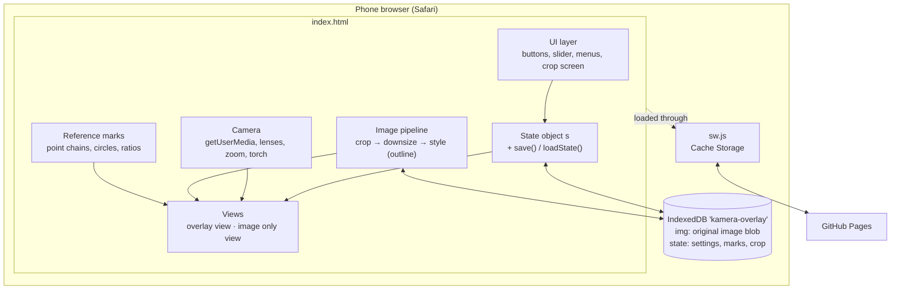
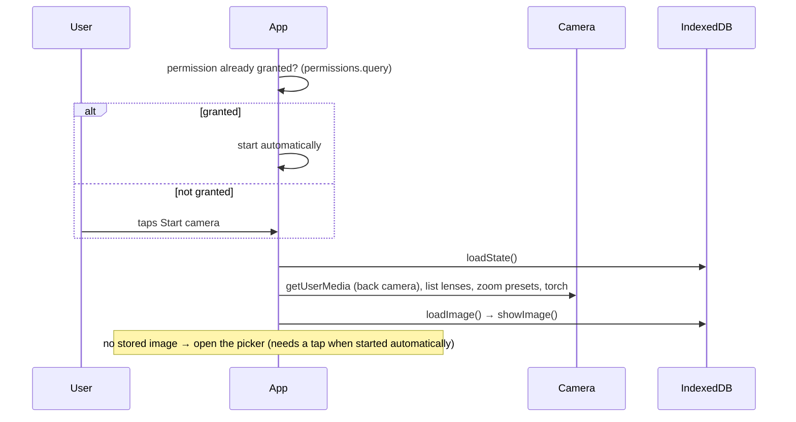

# Architecture

## Overview

Camera Overlay is a phone web app for quick sketching from a reference image. The phone is held or propped over the paper. The app shows the reference image semi-transparently on top of the live camera picture, so the outlines can be blocked in and proportions checked on the paper. A one-tap image only mode shows the reference by itself.

Design goals, in order:

1. **Speed and few taps.** The common actions (overlay on/off, image only) are one tap; everything else stays out of the way.
2. **Runs anywhere, nothing to install.** A static page with no dependencies or build step, served from GitHub Pages and installable to the home screen.
3. **Private.** Nothing leaves the phone: no server, accounts, analytics or uploads.
4. **Light on memory.** iOS reloads a page that uses too much memory, so images and layers are kept small (see [Memory](#memory)).

## Files

| File | Role |
|---|---|
| `index.html` | The whole app: markup, CSS (~190 lines) and JavaScript (~700 lines), inline |
| `sw.js` | Service worker: offline cache, network first with a 3 s timeout |
| `manifest.webmanifest`, `icons/` | Home screen install: name, icons, full-screen display |
| `README.md` | User-facing features and usage |
| `CLAUDE.md` | Rules for working on the code |

There are no libraries, frameworks or build tools. Every push to `main` is live on GitHub Pages.

## Runtime structure



## Screen layers

From back to front:

1. **Camera** (`#stage > video#v`): the live back camera, full screen. Digital zoom is a CSS scale on this element.
2. **Overlay frame** (`#ovw`): one element that carries the whole overlay transform (move, perspective tilt, rotation, size, mirror). Inside it, all in image coordinates so they move together:
   - `img#ov`: the working image (or its outline version), with the opacity setting
   - `svg#grid`: the alignment grid
   - `svg#ptsov`: reference marks on the overlay
3. **Image only view** (`img#ref` + `svg#ptsref` + `#refbar`): covers the screen when active. The image is shown straight, with its own zoom and pan.
4. **Controls**: the tool column (`#tools`), the big view toggles (`#views`), the adjustment slider (`#vs`) and its menu (`#menu`), the ⋯ menu (`#more`), and the zoom presets bar (`#bar`).
5. **Crop screen** (`#crop`): full screen on top of everything while open.

Body classes switch modes without moving elements: `solo` (image only), `ptsedit` / `ptsdel` (marks editing / delete mode), `vsleft`, `btnbottom`, `novs`, `toolcircle`.

## State and persistence

All state lives in one object, `s`. The keys listed in `KEYS` are saved, debounced by 300 ms, to IndexedDB under the key `state`; the original image is stored as a blob under `img`. On start, `loadState()` restores the saved keys, and `loadImage()` rebuilds the working image.

| Group | Keys |
|---|---|
| Overlay transform | `x`, `y`, `scale`, `rot`, `tx`, `ty`, `flip` |
| Visibility | `op`, `style`, `edge`, `line` |
| Camera | `zoom` |
| Image only view | `rz`, `rx`, `ry`, `rstyle`, `refPts` |
| Marks | `chains`, `chain`, `circles`, `showPts`, `ratios` |
| Image | `crop` |
| Layout and UI | `side`, `btnpos`, `param`, `lockCam`, `lockOv` |
| Migration | `fv` (frame version, see Memory) |

Rules:

- The database name `kamera-overlay` is kept from the original Finnish version so saved data still loads.
- A new saved setting is added to `KEYS` and given a default next to the others.
- Older saved data is migrated when it is loaded: a single `pts` list becomes chain A, and a missing `fv` converts the saved scale.
- Clear all deletes both entries and reloads.

## Main flows

### Start



A `starting` flag prevents two starts at once (which would open two camera streams).

### Choosing and cropping an image

1. The picked file is stored as the original in IndexedDB, and marks and crop are reset.
2. `showImage()` decodes the original, cuts out the crop and downsizes it to at most `MAXPX` (2400 px) as a JPEG blob: the **working image**. `IW×IH` is its size.
3. The overlay frame gets the size `FW×FH`, the working image scaled down to at most `FRAME` (800) CSS pixels. `fitImage()` fits a new image to the screen.
4. The crop screen opens. It shows a preview of at most 1600 px. On Done, `applyCrop()` moves the marks so they stay on the same image content, keeps the overlay content the same size on screen, and rebuilds the working image from the stored original. Because the original is kept, the crop can also be widened later.

### Overlay transform

`draw()` writes one CSS transform on `#ovw`:

```
translate(-50%,-50%) translate(x,y) perspective(…) rotateX(tx) rotateY(ty) rotate(rot) scale(scale·flip, scale)
```

The transform is set by touch (one finger moves; two fingers scale, rotate and move; the mouse wheel scales on desktop) and by the slider. Rotation and tilts snap to 0 within ±3°.

### Adjustment slider

Each adjustment is an entry in `P` with a group (`op`, `cam`, `ov`), a range, an optional logarithmic scale and `get`/`set` functions. The slider shows one adjustment at a time, colored by group. Dragging is relative, so the thumb does not jump to the finger. On a phone in landscape the same slider is drawn horizontally (`horiz()`).

Locks: `lockCam` blocks zoom; `lockOv` blocks moving, size, rotation, tilt and mirror. Opacity is never locked.

### Camera

- `openCam()` / `startCam()` use `getUserMedia`. On iPhone each back lens is its own device; `pickDevice()` picks the ultra wide lens for zoom below 1× and the wide lens otherwise, matching device labels, including Finnish ones.
- `setZoom()` switches lens if needed, then uses hardware zoom (`applyConstraints({zoom})`) and scales the video for any zoom beyond that. `queueZoom()` keeps camera reopens from overlapping while the slider is dragged.
- The torch button appears only when the track reports `torch` support, and the torch is turned on again after the camera is reopened.
- Close camera stops the tracks; zoom changes made while it is closed are kept for later.

### Visibility styles

- **Normal**: the working image.
- **Contrast**: a CSS filter (`grayscale + contrast`).
- **Outline**: `outlineURL()` draws the image on a canvas of at most 1200 px, computes Sobel edges, applies the Outline detail threshold, thickens the lines with a 3×3 maximum filter and returns a PNG blob URL. The overlay version has transparent background lines in the chosen color; the image only version has dark lines on white. Old blob URLs are revoked.

### Image only mode

`#ref` shows the working image with `object-fit: contain`, with its own zoom and pan (`rz`, `rx`, `ry`) and its own style. A tap without movement goes back to the overlay; dragging and pinching do not. `refToImg()` and `imgToRef()` convert between screen and normalized image coordinates.

### Reference marks

- **Data**: `chains` is a list of point chains (A, B, C…), each a list of `[x, y]` in normalized image coordinates; `circles` is a list of `[x, y, r]`, with `r` as a fraction of the image width.
- **Editing** happens in image only mode (✎ Edit), with a points tool, a circles tool and a separate delete mode, so that nothing is removed by accident.
- **Ratios**: each segment's length, and each circle's diameter, is shown relative to the first segment of chain A.
- **Drawing**: `ptsSVG(u)` builds the SVG for both views. `u` is image pixels per screen pixel, so marks keep the same size on screen at any zoom. On the overlay the marks sit inside `#ovw` and follow its transform.

## Memory

iOS reloads the page when it runs out of memory. The limits:

- The working image is at most `MAXPX` = 2400 px. The original is stored but only decoded briefly, when the working image is built.
- The 3D-transformed overlay frame is at most `FRAME` = 800 CSS px. Browsers render a transformed element as a layer of its full layout size, so this is the largest single saving. `s.scale` is relative to this frame; `fv` marks saved data that uses this convention.
- Canvases are as small as the job allows (outline 1200 px, crop preview 1600 px) and are released after use.
- Blob URLs are used instead of data URLs, and the old ones are revoked.

## Offline and install

`sw.js` caches the app files when installed, fetching them with `cache: 'reload'` so a stale HTTP cache cannot slip in. Each request goes to the network first. If the network fails or takes more than 3 s, the cached copy is served; the network result is still stored, inside `waitUntil`, so the next launch gets the new version. Cache keys ignore query strings. Only page loads fall back to `index.html`; other missing files fail normally. Bump `CACHE` when the caching logic changes, and add any new file the app needs offline to `FILES`.

## Testing

There is no test suite. Changes are checked with headless Chromium and Playwright, using a fake camera (`--use-fake-ui-for-media-stream --use-fake-device-for-media-stream`). The checks cover layouts at 320, 375 and 430 px wide and in phone landscape. Lens switching, hardware zoom and the torch can only be checked on a real iPhone.
